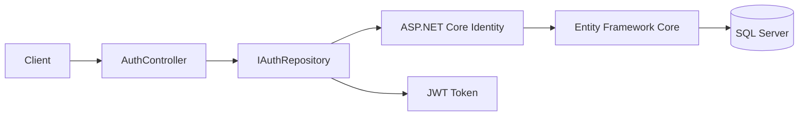

<div align="center">

# Registration API

### Secure user registration and JWT authentication with ASP.NET Core Identity

`ASP.NET Core 8` · `Identity` · `JWT` · `Entity Framework Core` · `SQL Server` · `Swagger`

</div>

## Overview

Registration API is a focused authentication service for creating users, validating credentials, and issuing JSON Web Tokens. ASP.NET Core Identity handles password hashing and user persistence, while a repository layer keeps authentication logic separate from the controllers.

## Features

- Register users with username, email, phone number, and password.
- Authenticate existing users and return a signed JWT access token.
- Store users securely through ASP.NET Core Identity.
- List registered users through the display endpoint.
- Explore and test endpoints using Swagger UI in Development.
- Persist data with Entity Framework Core and SQL Server.

## API endpoints

| Method | Endpoint | Purpose |
|---|---|---|
| `POST` | `/api/Auth/Register` | Create a new account |
| `POST` | `/api/Auth/Login` | Validate credentials and return a JWT |
| `GET` | `/api/Auth/Display` | Return registered users |

### Register request

```json
{
  "username": "mostafa",
  "email": "mostafa@example.com",
  "phone": "+201000000000",
  "password": "StrongPassword123!"
}
```

### Login request

```json
{
  "username": "mostafa",
  "password": "StrongPassword123!"
}
```

## Architecture



## Project structure

```text
RegistrationAPI/
├── Controllers/       Authentication HTTP endpoints
├── Data/              Identity database context
├── DTOs/              Login and registration contracts
├── Models/            Application user model
├── Repositry/         Authentication abstraction and implementation
├── Migrations/        Entity Framework migrations
└── Program.cs         Dependency injection and middleware
```

## Run locally

### Prerequisites

- .NET 8 SDK
- SQL Server or SQL Server Express
- EF Core CLI: `dotnet tool install --global dotnet-ef`

```bash
git clone https://github.com/MostafaMedhat19/RegistrationAPI.git
cd RegistrationAPI/RegistrationAPI
dotnet restore
```

Configure the database and JWT settings with environment variables or .NET User Secrets:

```bash
dotnet user-secrets init
dotnet user-secrets set "ConnectionStrings:TheConnection" "YOUR_SQL_SERVER_CONNECTION"
dotnet user-secrets set "JWT:SecreKey" "YOUR_LONG_RANDOM_SIGNING_KEY"
dotnet user-secrets set "JWT:Issuer" "https://localhost:7001"
dotnet user-secrets set "JWTt:Audience" "https://localhost:7001"
dotnet ef database update
dotnet run
```

Open the Swagger URL printed by the application, typically `/swagger` in Development.

> The current source reads the audience from `JWTt:Audience` (with two `t` characters). For a cleaner configuration, rename that lookup in `Program.cs` to `JWT:Audience`, then use the corrected key everywhere.

## Security notes

- Never commit production connection strings or signing keys.
- Use HTTPS and a strong randomly generated JWT signing key.
- Protect administrative user-listing endpoints with authorization policies before production use.
- Refresh tokens, role-based authorization, rate limiting, and automated security tests are recommended next steps.

## Author

[Mostafa Medhat](https://github.com/MostafaMedhat19)
